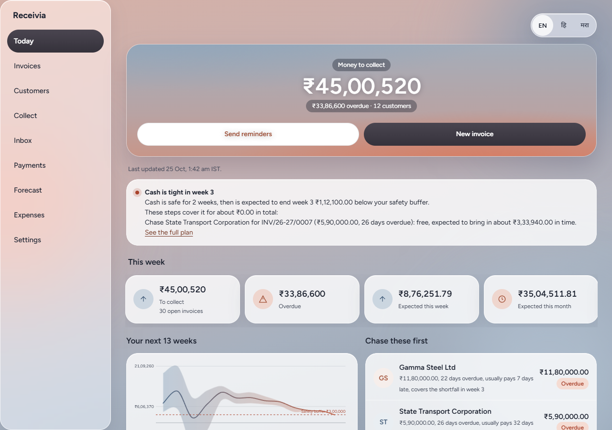
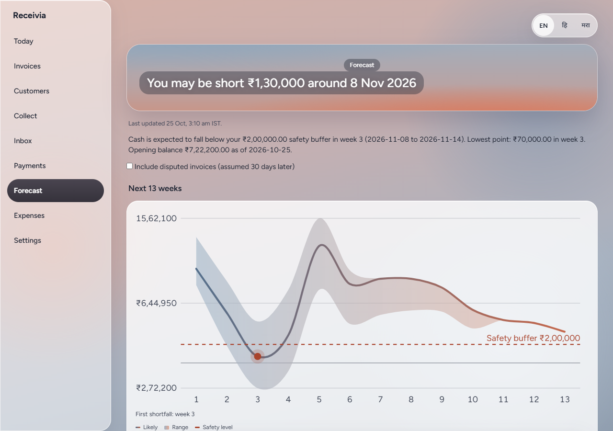
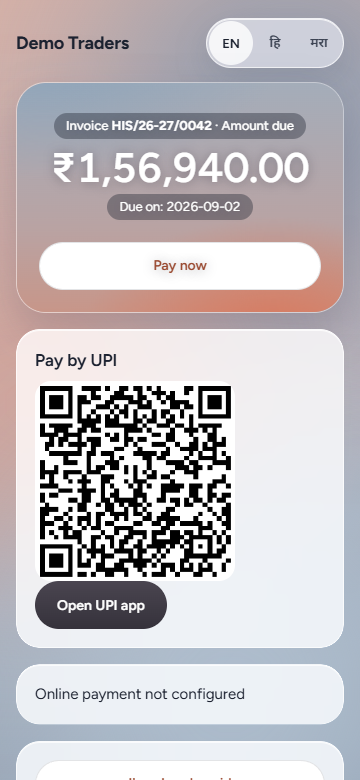
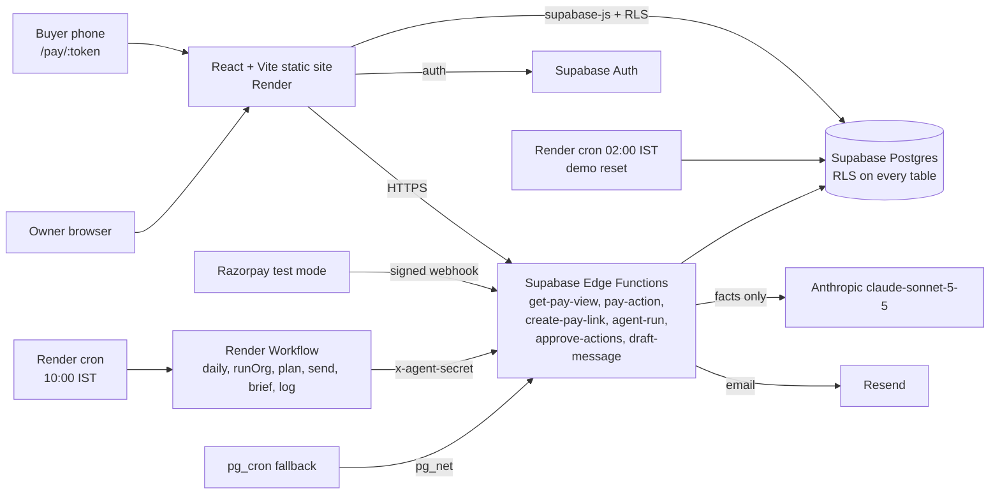

# Receivia

**Collections and cash-flow for small Indian businesses: know when the cash will really arrive, chase the right buyer first, and get paid without the awkward phone calls.** It sits on top of Tally and Vyapar.

- **Live demo:** https://receivia.onrender.com (press **Open live demo**, no sign-up; works signed out on phone and laptop)
- **Video:** `VIDEO_LINK_PLACEHOLDER` (4:30 walkthrough, script in [docs/demo-script.md](docs/demo-script.md))
- **Deck:** https://docs.google.com/presentation/d/1mSE1vTZvlRFA_0F9jqZMY1InD5XvmBRq/edit?usp=sharing (text in [docs/deck.md](docs/deck.md))
- **First load:** the static site is always on, but the Supabase project and Render services can take a few seconds to wake after idle time. If **Open live demo** spins for more than ten seconds, wait and press it once more.

| Today | Forecast | Buyer pay page (phone) |
|---|---|---|
|  |  |  |

## The problem

Late payment is the main cash problem for small suppliers. The Recordent *SME Receivables Report 2026* puts the average settlement time at **73 days**. The MSME Samadhaan portal shows delayed-payment claims of **₹55,244 crore** filed by micro and small enterprises. Owners know they are owed money but not *when* it will arrive, so a good month on paper still ends with a salary day they cannot cover. Chasing is awkward, so it is done late or not at all.

**Who it is for:** a manufacturer, trader or service business with a few employees, 10 to 500 customers, invoices in Tally or Vyapar (or a spreadsheet), and an owner who does the collections themselves. The demo is *Shree Ganesh Corrugators*, a micro-enterprise box maker in Pune with 12 customers.

## What it does

| Pillar | What you get |
|---|---|
| **Import and GST invoicing** | CSV, Excel and Tally XML import (idempotent, bad rows listed). Invoices, credit and debit notes, print-ready A4 documents, UPI QR, amount in words with lakh and crore. |
| **Buyer Compliance Lens** | One hedged line per reminder that tells the buyer how paying late may affect *their* tax and MSME position (below). |
| **Governed collections agent** | A rules-based ladder (friendly, reminder, final, Payment Demand Letter, next steps) with an AI-worded message that the owner approves. |
| **Buyer pay portal** | `/pay/:token` on a phone: amount, UPI QR, Razorpay link, "I have already paid", dispute, "I will pay on". In English, Hindi or Marathi. No login. |
| **Reconciliation and TDS** | Bank CSV import, suggested matches with reasons, TDS-aware (a short payment explained as 2% GST TDS, 194C or 194Q), a certificates page and a 26AS/AIS check. |
| **Probabilistic forecast and gap solver** | 13-week cash forecast with a P10/P50/P90 band, what-ifs, a ranked "chase these first" list, and a plan that closes a shortfall with named, costed steps. |
| **Owner brief** | A daily email in the owner's language: "3 to chase today, ₹2.1L, shortfall risk week 3", with an Approve-all link. (WhatsApp via links, see *Real vs simulated*.) |
| **Payability** | Before an invoice is issued, a checklist scores how likely it is to be paid on time (PO, GSTIN, HSN digits, e-way bill, accounts-payable contact, due date). Below the threshold it asks you to fix the gaps; at 85 or more the invoice is marked *ready to get paid*. |
| **Acceptance, statements and instalments** | Each invoice records how it was accepted (assumed, buyer confirmed, proof uploaded) for the 43B(h) clock. The pay link also offers a customer statement and "pay in parts" instalment requests that the owner approves. |
| **Explainability** | A "?" on every computed figure opens the formula, inputs, source rows and law. [/how-it-works](https://receivia.onrender.com/how-it-works) lists every rule and shows the live AI accuracy and the impact replay. |
| **AI reply understanding and Ask your books** | A pasted buyer reply (English, Hindi, Marathi, Hinglish) becomes a promise, claim or dispute that rules re-check; "Ask your books" answers questions from read-only tools, and every figure is taken from a tool result. Both fall back to rules without the model. |
| **Impact replay** | Replays the last 6 months with and without Receivia (days to collect, interest saved, hours saved) with the assumptions shown. Estimates, not promises. |
| **Government buyers** | Government and PSU customers get formal email only, formal wording and no WhatsApp. |
| **National impact estimate** | A public [/impact](https://receivia.onrender.com/impact) page: sliders for adopters, receivables, days faster and borrowing rate give working capital freed and interest saved a year, with sources and assumptions listed. An estimate, not a promise. |
| **AI invoice reader** | *Scan invoice* reads a photo or PDF (up to 5 MB, never stored) with Claude vision, then fixed rules audit it: GSTIN check digit, GST recomputed with the app's own engine, CGST/SGST against IGST by state, printed against correct with the rupee difference. It prefills New invoice for review and never saves by itself. Samples in `docs/samples`. |
| **Buyer negotiation chat** | *Talk to accounts* on the pay page. The model has five tools only (instalments, early-pay discount, promise date, dispute, read-only facts). Every limit (owner-set discount %, instalments, promise days) is enforced in the database, every turn and tool call is logged, and the owner sees it in the Inbox. Off by default; falls back to the buttons. |
| **Voice ask** | A mic on *Ask your books* (hi-IN, mr-IN, en-IN via the browser's Web Speech API) and answers read aloud. Hidden where the browser does not support it. |
| **Trust layer** | A public [/trust](https://receivia.onrender.com/trust) page that runs the GST, GSTIN, words, ladder, matching and forecast checks in your browser. |

### Buyer Compliance Lens

Reminders can carry one factual line about the *buyer's* own position. Every line is hedged ("may", "generally"), names the section, and ends with **"General information, not legal or tax advice."**

| Rule | Reference | Shown when |
|---|---|---|
| Input tax credit may need to be reversed if the supplier is not paid within 180 days of the invoice date | CGST Act s16(2) and Rule 37 | the buyer has a GSTIN |
| A purchase from a micro or small supplier is deductible only in the year it is paid when paid after the MSMED due date | Income-tax Act s43B(h) | the seller is a registered micro or small enterprise (Udyam) and the buyer is not an individual, government body or presumptive-tax payer |
| Payment due within the agreed period (at most 45 days with a written agreement, otherwise 15 days) and interest at three times the bank rate, compounded monthly | MSMED Act ss15-16 | the seller is a registered micro or small enterprise |
| Companies report amounts outstanding more than 45 days to micro and small suppliers | MSME Form I (half-yearly) | company buyers, stated as general information |

Priority: 43B(h) for eligible MSME sellers, else the 180-day ITC line when the buyer has a GSTIN. Individuals and government buyers never get the 43B(h) line. The rates and thresholds live in `src/lib/legal/config.ts` (RBI bank rate marked "verify").

### How GST is calculated

- Integer paise everywhere; rupees are converted once at the form edge (`src/lib/money`).
- Per line: taxable = qty x rate - discount; tax per line rounded to the paisa. Same state (first two GSTIN digits): CGST and SGST each at half the rate, rounded separately. Other state: IGST. A round-off line brings the total to the nearest rupee.
- Rates are config, not code (0, 0.25, 3, 5, 18, 40, "verify on cbic-gst.gov.in").
- **Invoice types:** a regular supplier issues a *Tax Invoice*; a composition supplier issues a *Bill of Supply* headed "Composition taxable person, not eligible to collect tax on supplies"; an unregistered supplier issues a plain invoice. An e-invoice note appears when turnover is above ₹5 crore.
- GSTINs are checked with the mod-36 check digit; amounts in words follow the Indian system (lakh, crore) in English, Hindi and Marathi.

### The collection ladder and the Payment Demand Letter

Stages run from three days before the due date to 45 days after (friendly, due today, reminder at +7, final at +15 with a call prompt, Payment Demand Letter at +30, next steps at +45). A buyer claim, dispute or promise pauses the ladder for that invoice. Key-tier customers always need the owner's approval for each stage, and one message per customer per day is enforced in the database.

The letter is called a **Payment Demand Letter**, never a legal notice. Near the top it says: *"This letter is from <business> about money owed for the invoices listed below. It is not a notice from the GST department and not a legal notice from a lawyer."* It carries no emblem, seal or threat, and it never goes through the AI model. A test strips the one mandated sentence and checks that "legal notice" appears nowhere else.

### Matching and TDS

Bank lines are matched on three kinds of evidence: the invoice number named in the narration (any spacing or separator), the customer name (M/s, Pvt, Ltd ignored) and the amount. Nothing is applied automatically. A short payment is called TDS only if the shortfall equals rate x taxable value within ₹1 for that buyer type (GST TDS 2% for government, 194C, 194J, 194H, 194Q 0.1%, GST TCS). Confirming creates the payment, the allocations and the TDS entry in one transaction, idempotent per bank line (SHA-256 dedupe key).

### Forecast method

1. **Delay model.** Per customer, days between due date and payment from paid history, shrunk towards the overall pattern with weight w = n/(n+5), so a new customer with two invoices is not judged on two points. Grades A/B/C come from the shrunk P80 delay.
2. **Monte Carlo.** 2,000 runs with a fixed seed over the next 13 weeks. Each open invoice arrives at due date plus a sampled delay, conditioned on not having arrived yet; reminder stage, an active promise (65% chance of landing on the date), a dispute and a bad-debt mass for very old invoices adjust it. Outflows (salaries, rent, GST, supplier bills) are known dates. Identical inputs always give identical numbers.
3. **Output.** Weekly P10/P50/P90 closing balance, probability of falling under the safety buffer, first shortfall week.
4. **Backtest.** Hide the last 8 weeks, forecast them, compare with what was paid: weighted absolute percentage error (WAPE) is shown on the Forecast page.
5. **Gap solver.** For the first shortfall week it lists candidate actions: chase an invoice (free), offer an early-payment discount (2%), sell an invoice on TReDS (company and government buyers), or defer a deferrable supplier bill (1.5% a month). It picks greedily by cost per rupee covered, then drops any paid step that is no longer needed. A test checks it never beats brute force and stays within one action's cost of it. Fee rates are assumptions to confirm with your bank.

### Agent guardrails

- **Numbers come from the database only.** The model sees structured facts and returns text with slot tokens (`{{amount}}`, `{{due_date}}`, `{{pay_link}}`); amounts, dates, names and links are filled at send time from the database.
- **A validator rejects** any draft containing digits (including Devanagari), number words, a rupee sign, links, unknown or missing slots, banned words or a bad length. Failure, or no API key, falls back to the stage template. Customer text (for example a dispute reason) is wrapped in delimiters and cannot change an amount.
- **The owner approves.** Autonomy defaults to L0 (suggest only). L1 and L2 auto-approve only friendly and reminder stages (final at L2) for standard-tier customers; demand letters, next steps and key customers always need a person. Test mode (default on) sends only to the owner.
- **Everything is audited.** Each action stores its reasoning, policy checks, approver and decision log; the append-only audit log records every change.

## Architecture

React 18, Vite, TypeScript (strict), Tailwind, TanStack Query, zod, react-hook-form, i18next (English, Hindi, Marathi). Supabase region ap-northeast-1. The agent logic lives once (`src/features/agent/server.ts`, bundled for the edge runtime); the Render Workflow, pg_cron and the local runner are thin callers, so every path does the same job. The Workflow gives every step its own retries (3, exponential backoff) and writes a run log per business.

## Security and privacy

- **Row-level security on every table**, written so one hashed sub-plan answers membership per query. Roles: owner full; accountant read/write except organisation, members and business profile; CA read-only. Child tables use composite foreign keys `(parent_id, org_id)`, so a row cannot point at another business's parent, and `org_id` is immutable.
- **Isolation tests** run every table as a second business's user and assert zero rows read and zero rows written (207 pass on real Postgres).
- **Append-only audit log**: a database trigger blocks UPDATE, DELETE and TRUNCATE for everyone; rows are written only by triggers.
- **Pay links** are random tokens stored as SHA-256 with an expiry; the public page reads through functions bound to that token's invoice and returns no organisation id; per-IP rate limits.
- **Secrets** only in environment and Supabase secrets; the repository holds only the public Supabase URL and anon key (`.env.production`). The Anthropic key is used only inside edge functions.
- **DPDP controls**: a privacy notice (`/privacy`), per-customer per-channel consent records that the planner respects, export of all data as JSON/CSV, deletion of an organisation by typing its name (the audit trail is scrubbed of personal data and keeps one `ORG_ERASED` row), an error log without form values.
- Accessibility: axe finds 0 serious or critical issues on 15 routes in three languages; no horizontal overflow at 360 px.

## Tests

| Suite | Command | Count |
|---|---|---|
| Unit and property tests (money, GST, GSTIN, legal, ladder, matching, forecast, agent, i18n, trust) | `npm test` | 456 |
| Database tests on PGlite with the real migrations | `npm run test:db` | 49 |
| Isolation and numbering on real Postgres | `npm run test:db:remote` | 207 |
| Browser tests (axe, 360 px, offline, the live demo story) | `npm run e2e` (live: `LIVE_URL=https://receivia.onrender.com PW_CHANNEL=chrome npx playwright test tests/e2e/demo-story.spec.ts`) | 6-step story |

Run the app: `npm install && npm run dev` (needs `.env` from `.env.example`). Reset and re-seed the demo organisation: `node scripts/reset-demo.mjs` (demo org only). The [/trust](https://receivia.onrender.com/trust) page shows the invariants running live.

## Real vs simulated

| Real | Simulated or not connected |
|---|---|
| Invoicing, GST maths, import, ladder, forecast, solver, matching, TDS logic, pay portal, claims, disputes, Inbox | **Razorpay**: no account keys are set, so the pay page says "Online payment not configured"; the payment path is verified with a signed mock webhook. UPI QR works. |
| Email through Resend (to the owner only in test mode) | **WhatsApp**: sent as `wa.me` links the owner taps; the Cloud API code path exists but is off. |
| Supabase auth, RLS, audit, edge functions, Render cron and Workflow | **GST IMS and Account Aggregator**: not connected; the IMS table and bank-statement import stand in. |
| AI wording and reply understanding through the Anthropic API from edge functions | Live. Falls back to stage templates and rules when the model is unavailable. Accuracy on the sample set is on /how-it-works. |
| | **Data**: Shree Ganesh Corrugators, its customers, GSTINs, phones and bank details are made up. The Hindi and Marathi text is machine-written and awaits a native-speaker review. |

## What is next

TReDS and Razorpay live keys; a verified sending domain and the WhatsApp Cloud API; IMS and Account Aggregator feeds; a native review of Hindi and Marathi legal lines; separate test and production Supabase projects (Mumbai region); a CA read-only workspace for periodic reviews.
